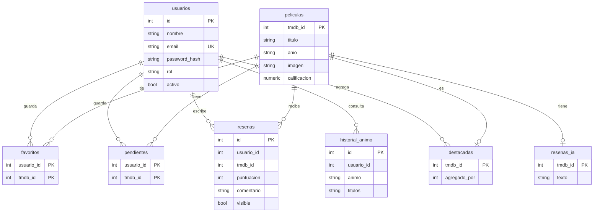

# 🎬 CineFinder v2

Recomendador de películas con **TMDB**, **OMDb** y **Groq (IA)**, ahora con **base de datos PostgreSQL**, **cuentas de usuario**, **favoritos**, **reseñas** y **panel de administración**.

## ✨ Qué incluye

| Para el usuario | Para el administrador |
|---|---|
| Registro e inicio de sesión (contraseñas cifradas con bcrypt) | Panel `/admin.html` protegido por rol |
| Favoritos y "Ver más tarde" guardados en la BD (te siguen en cualquier dispositivo) | Estadísticas: usuarios, favoritos, reseñas, estados de ánimo |
| Reseñas con estrellas (1–5) + promedio de la comunidad | Gestión de usuarios: hacer admin, desactivar, eliminar |
| "Recomendadas para ti" según tus favoritos | Moderación de reseñas: ocultar / eliminar |
| Perfil: cambiar nombre y contraseña, ver mis reseñas | Película "Selección de CineFinder" en la portada |
| Calificación IMDb y Rotten Tomatoes (OMDb) | |
| Reseña de IA guardada en caché (carga más rápido y gasta menos Groq) | |

## 🗄️ Base de datos (8 tablas)



El script completo está en [`db/schema.sql`](db/schema.sql). Se ejecuta solo al iniciar el servidor.

## 🧱 Estructura

```
server.js            → arranque, seguridad, rutas
db/                  → schema.sql (tablas) y pool.js (conexión)
middleware/auth.js   → sesión con JWT en cookie httpOnly, roles
routes/              → auth, usuario, peliculas, resenas, ia, admin
services/            → tmdb.js, omdb.js, groq.js, cache.js
public/              → index.html, admin.html, css/, js/, img/
```

## 💻 Probar en tu PC

1. Instala **Node 18+** y **PostgreSQL** (o usa una BD gratis en la nube, ver abajo).
2. `npm install`
3. Copia `.env.example` a `.env` y completa tus claves y `DATABASE_URL`.
4. `npm start` → abre http://localhost:3000
5. Entra con el correo/clave de `ADMIN_EMAIL` / `ADMIN_PASSWORD` para ver el panel admin.

## 🔐 Seguridad aplicada

Contraseñas con bcrypt · sesión en cookie `httpOnly` · consultas SQL parametrizadas · límite de intentos en login y en la IA · cabeceras `helmet` (CSP) · texto de usuarios escapado (anti-XSS) · claves solo en variables de entorno (`.env` está en `.gitignore`).

Guía de despliegue paso a paso: ver la conversación / sección "Despliegue" del informe.
